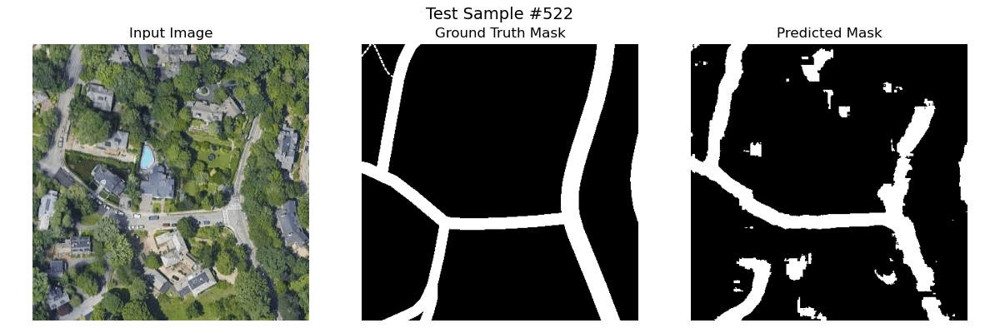
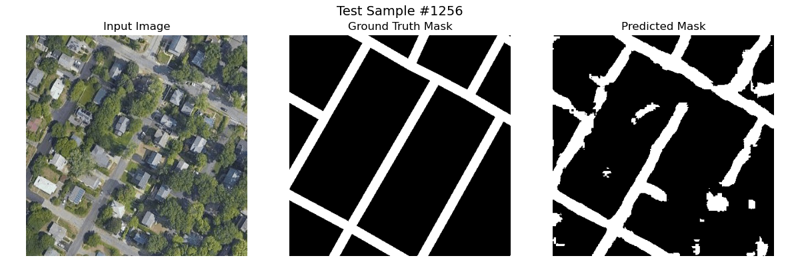
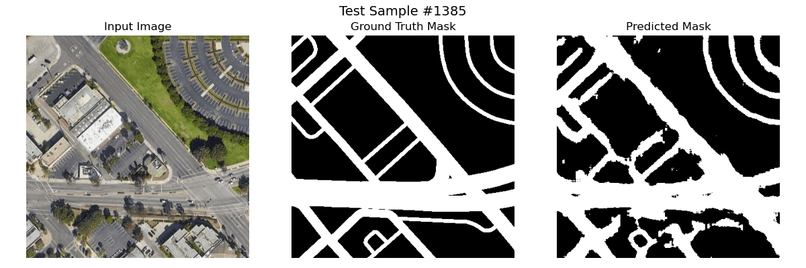

# Road Segmentation with U-Net

A semantic segmentation project that detects road networks in satellite imagery using a U-Net convolutional neural network built with PyTorch. The model performs pixel-level binary classification, labeling each pixel as either **road** or **background**.

This project was developed for **ECS 174: Computer Vision at UC Davis**.

## Results

The final model achieved an approximately **72% Dice score** on the held-out test set. Dice coefficient was selected as the primary metric because road pixels occupy a relatively small portion of each image and pixel accuracy can therefore be misleading.

<p align="center">
  
</p>

## Key Features

- Implemented a U-Net encoder-decoder architecture from scratch in PyTorch
- Used skip connections to preserve spatial details during reconstruction
- Built a custom dataset and data-loading pipeline for paired satellite images and masks
- Split the dataset into 70% training, 15% validation, and 15% testing sets
- Combined weighted binary cross-entropy and Dice loss to address class imbalance
- Added optional image augmentation, normalization, checkpointing, and metric visualization
- Supported training on NVIDIA CUDA, Apple Silicon MPS, and CPU

## Model Architecture

The model follows the U-Net architecture:

- **Encoder:** Four convolutional blocks with max pooling for feature extraction
- **Bottleneck:** 1,024-channel representation of high-level spatial features
- **Decoder:** Transposed convolutions for upsampling
- **Skip connections:** Concatenate encoder features with decoder features at matching resolutions
- **Output layer:** `1 × 1` convolution producing a binary road mask

The network accepts RGB images resized to `400 × 400` and outputs a single-channel segmentation map.

## Tech Stack

- Python
- PyTorch
- Torchvision
- NumPy
- Pillow
- Matplotlib
- Scikit-learn

## Project Structure

```text
.
├── main.py                 # Training pipeline and hyperparameters
├── unet.py                 # U-Net model architecture
├── dataset.py              # Dataset class, preprocessing, and data loaders
├── train.py                # Training loop and combined loss function
├── eval.py                 # Dice-based model evaluation
├── dice_coeff.py           # Dice coefficient implementation
├── final_evaluation.py     # Test evaluation and prediction visualizations
├── image_split.py          # Reproducible train/validation/test split
├── plot.py                 # Training metric plots
├── final_eval_outputs/     # Test score and sample predictions
└── *.pth                   # Trained model checkpoints
```

## Dataset

The project uses the **Road Segmentation: Boston & Los Angeles** dataset from Kaggle, containing satellite images and corresponding road masks.

Dataset: [Road Segmentation — Boston & Los Angeles](https://www.kaggle.com/datasets/timothlaborie/roadsegmentation-boston-losangeles)

Organized as follows:

```text
data/
├── train/
│   ├── images/
│   └── masks/
├── val/
│   ├── images/
│   └── masks/
└── test/
    ├── images/
    └── masks/
```

## Example Predictions

Each visualization compares the satellite image, ground-truth road mask, and model prediction.

<p align="center">
  
</p>

<p align="center">
  
</p>

## Challenges and Design Decisions

Road segmentation is highly imbalanced because background pixels significantly outnumber road pixels. A model trained only with standard binary cross-entropy may obtain deceptively strong pixel accuracy by predicting mostly background. To reduce this issue, the training objective combines:

- **Weighted binary cross-entropy**, which increases the penalty for incorrectly classified road pixels
- **Dice loss**, which directly optimizes overlap between predicted and ground-truth road regions

This combination improved the model's ability to identify narrow and connected road structures.

